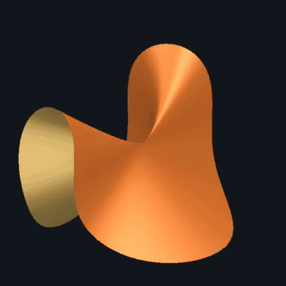

# Algebraic Variety Explorer — project notes

[Back to the Android app](../README.md)

This guide describes the Java version on the `surfer` branch. Run the commands below from the repository root.

## Building and testing

There is no Gradle project and no generated directory hierarchy in the source
tree. The build is an explicit sequence of Android command-line operations:
resource compilation, Java compilation, conversion to DEX, APK assembly,
alignment, and optional signing.

Requirements:

- Bash, curl, zip, and unzip
- JDK 17
- Android SDK platform 35
- Android build tools 35.0.1

Set `ANDROID_SDK_ROOT` to the SDK directory, then run:

```sh
./build.sh
```

That produces a signed development APK under `.build`. The first build creates
a persistent local `.debug.keystore`; do not use that key for a published
release.

Other commands:

```sh
./build.sh release
./build.sh diagnostic
./build.sh test
./build.sh preview
./build.sh clean
```

`release` produces an aligned but unsigned APK for F-Droid or external signing.
`diagnostic` uses the separate package
`org.algebraicvarietyexplorer.local`, allowing it to install beside any
remaining copy of the real application. It is only an installation diagnostic
and must not be uploaded as the release.
The exact external Java dependencies and SHA-256 hashes are recorded in
[`dependencies.lock`](../dependencies.lock). They are downloaded into the ignored `.dependencies`
directory unless `ANTLR_JAR`, `VECMATH_JAR`, `JUNIT_JAR`, or `HAMCREST_JAR`
points to a supplied copy.

R8 keeps all project classes and members unchanged. Its only shrinking job is
to remove unreachable desktop-only classes from the old ANTLR and Vecmath
dependency jars before they reach Android.

## Read the source in this order

The Android adaptation is small. Start with these files:

1. [`MainActivity.java`](../MainActivity.java) — the whole screen-level sequence: connect the views,
   configure input and buttons, request renders, and save PNG files.
2. [`SurfaceRenderController.java`](../SurfaceRenderController.java) — runs one render at a time and returns the
   newest result to the screen.
3. [`RendererEngine.java`](../RendererEngine.java) — translates the app's formula, camera, material,
   lighting, and quality choices into calls to jsurf.
4. [`AlgebraicSurfaceView.java`](../AlgebraicSurfaceView.java) — displays the bitmap and turns drag/pinch
   gestures into rotation and zoom.
5. [`RenderRequest.java`](../RenderRequest.java), [`RenderResult.java`](../RenderResult.java), and [`RenderQuality.java`](../RenderQuality.java) — the
   plain data passed through the rendering boundary.
6. [`PngExporter.java`](../PngExporter.java) — writes a rendered bitmap.
7. [`SurfaceExample.java`](../SurfaceExample.java) and [`SurfaceExamples.java`](../SurfaceExamples.java) — the example list.

The execution path is:

```text
MainActivity
    → SurfaceRenderController
        → RendererEngine
            → CPUAlgebraicSurfaceRenderer
```

Files whose package begins `de.mfo.jsurf` are the inherited 2008 ray tracer and
algebra library. They retain the original style because rewriting working
numerical code merely to make it look newer would make this first port harder
to verify.

[`AlgebraicExpression.g`](../AlgebraicExpression.g) and [`AlgebraicExpressionWalker.g`](../AlgebraicExpressionWalker.g) are the readable
grammar sources. [`AlgebraicExpressionLexer.java`](../AlgebraicExpressionLexer.java),
[`AlgebraicExpressionParser.java`](../AlgebraicExpressionParser.java), and [`AlgebraicExpressionWalker.java`](../AlgebraicExpressionWalker.java) are
checked-in ANTLR-generated output. They are required by the current standalone
build but are not the files to read or edit when changing the grammar.

## Flat source layout

The Java sources, grammar files and Android resource XML files are at the repository root. Java package declarations remain
unchanged; Java does not require source files to be stored in matching package
directories when they are passed to the compiler explicitly.

- `*.java` contains application and jsurf source.
- `*.test.java` contains JVM tests and the visual smoke test.
- `drawable.*.xml`, `layout.*.xml`, and `values.*.xml` are Android resources.
- `*.g` contains the original ANTLR grammar.
- `store.*.txt` contains F-Droid listing text.

Android's resource compiler requires `drawable`, `layout`, and `values`
directories. `build.sh` reconstructs those directories temporarily under
`.build` and leaves the repository flat.

The two original packages each had a file called [`Helper.java`](../Helper.java). The
package-private CPU renderer file is stored as [`CpuHelper.java`](../CpuHelper.java); its contents
and class name are unchanged. The three generated ANTLR Java files remain
checked in and are compiled directly, so building does not require the ANTLR
generator.

## Example surfaces

- Original polynomial parser and CPU ray tracer from jsurf
- Drag to rotate and pinch to zoom
- Sphere, torus, Cayley cubic, Whitney umbrella, Roman surface, and heart examples
- PNG export through Android's system file picker
- No internet permission, ads, analytics, account, or native libraries

The app draws the real zero set inside a sphere. Use `^` for powers and write multiplication explicitly with `*`. For example:

```text
(x^2+y^2+z^2+0.4)^2-1.1*(x^2+y^2)
```

## Madore’s E₆ cubic

The **Madore E6 cubic** example renders the exact real polynomial
`x^2+x*z^2+y^3=0` with Christian Stussak's original SURFER/jsurf
ray tracer. The formula comes from **David A. Madore's**
[2006 *Cubic Surfaces DVD*](http://www.madore.org/cubic-dvd/),
original scene `03s01a.pov`. We thank both authors, with their
distinct public-domain and Apache-2.0 source terms preserved.

See the [cross-render mathematical note](../notes/e6-madore-compare.md),
[rotating SURFER movie](../renders/madore-e6/madore-e6-surfer.mp4),
[inline GIF](../renders/madore-e6/madore-e6-surfer.gif),
and the corresponding [original POV-Ray rendering in
`resolution`](https://github.com/isomorphisms/resolution/tree/main/renders/madore-e6).

Reproduce and check the JSURF frames, MP4 and GIF:
`bash tools/render-madore-e6.sh renders/madore-e6`.



## F-Droid submission

See [`fdroid.README.md`](../fdroid.README.md) and [`org.algebraicvarietyexplorer.yml.template`](../org.algebraicvarietyexplorer.yml.template).

The repository has separate gates for source/renderer tests, signed emulator
smoke tests on the minimum and target Android API levels, byte-identical clean
unsigned builds, APK policy inspection, and a production-like F-Droid recipe
run. These checks provide build evidence; they do not replace final testing of
the exact candidate on real hardware or F-Droid's own review.

## Attribution and license

**Christian Stussak wrote the original Java `jsurf` ray tracer** (copyright
2008) and its algebraic-surface rendering core, retained in this repository's
`de.mfo.jsurf` classes. The original source is published at
[IMAGINARY/jsurf](https://github.com/IMAGINARY/jsurf).
This application depends directly on that implementation.

The wider [SURFER project](https://www.imaginary.org/program/surfer) was
developed by IMAGINARY with the Mathematisches Forschungsinstitut Oberwolfach
and Martin Luther University Halle-Wittenberg. The project credits
**Gert-Martin Greuel** (direction), **Christian Stussak** (Java renderer),
**Maik Urbannek** (JavaFX), and **Henning Meyer** (previous version), with
additional coordination, design, galleries, and text contributors recorded
on the official project page. Do not attribute those contributions to the
Android adaptation or to Stussak alone.

The Android adaptation is independent and not an official IMAGINARY release.
The original `jsurf` code and this adaptation are distributed under the
Apache License 2.0. Preserve [`LICENSE`](../LICENSE), [`NOTICE`](../NOTICE), the per-file copyrights,
and [`THIRD_PARTY_LICENSES.md`](../THIRD_PARTY_LICENSES.md) when distributing or translating the work.

The Android interface, touch controls and packaging were developed in conversation with ChatGPT 5.6. This experimental port has not received an independent code or mathematical review. [Open issues](https://github.com/isomorphismes/algebraic-variety-explorer-mobile/issues) track reported defects and proposed changes.
